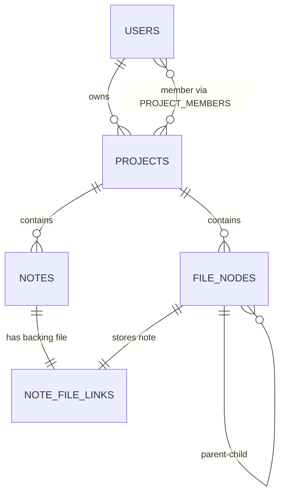
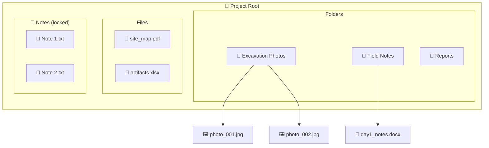
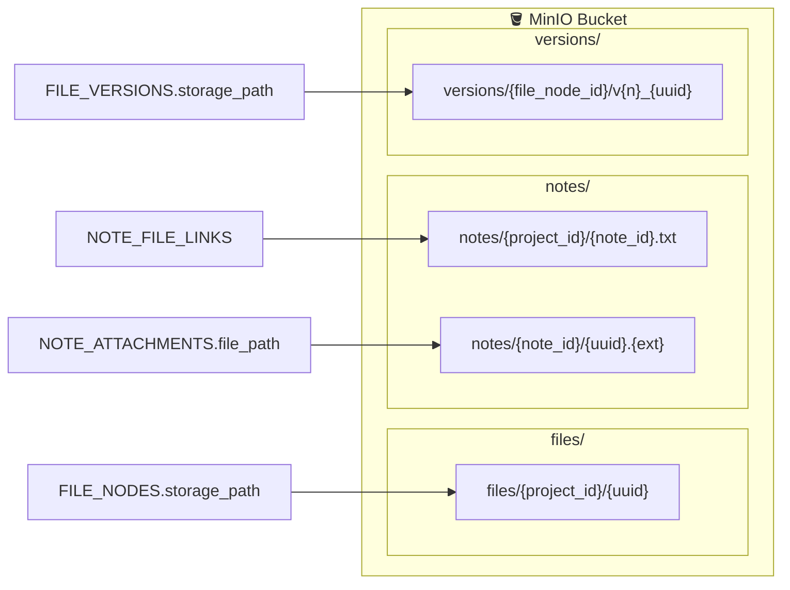
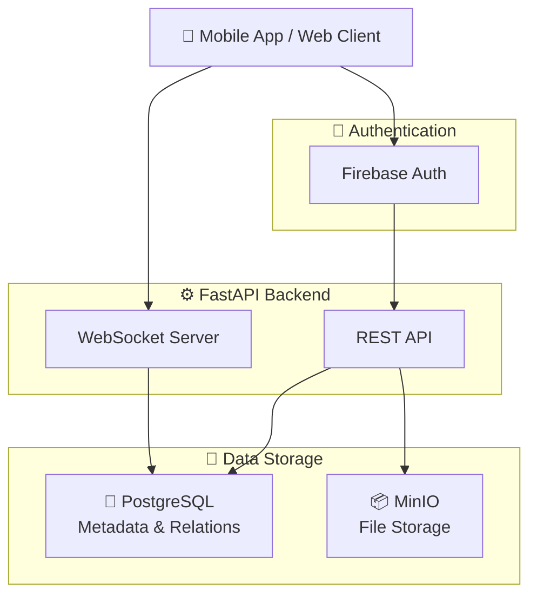
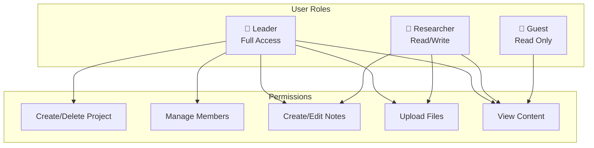
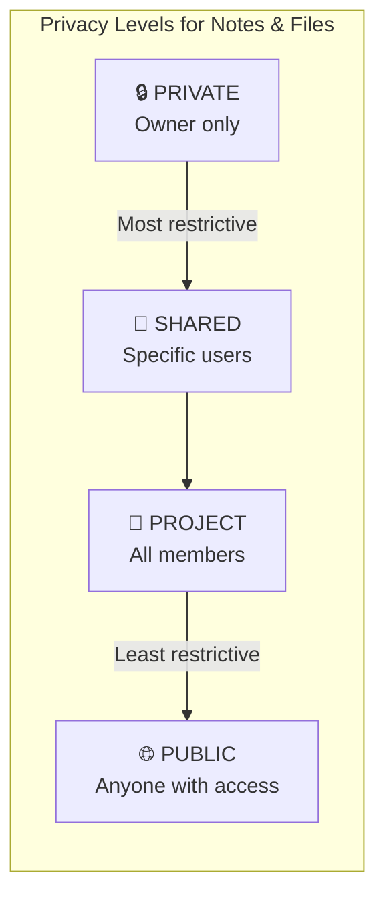
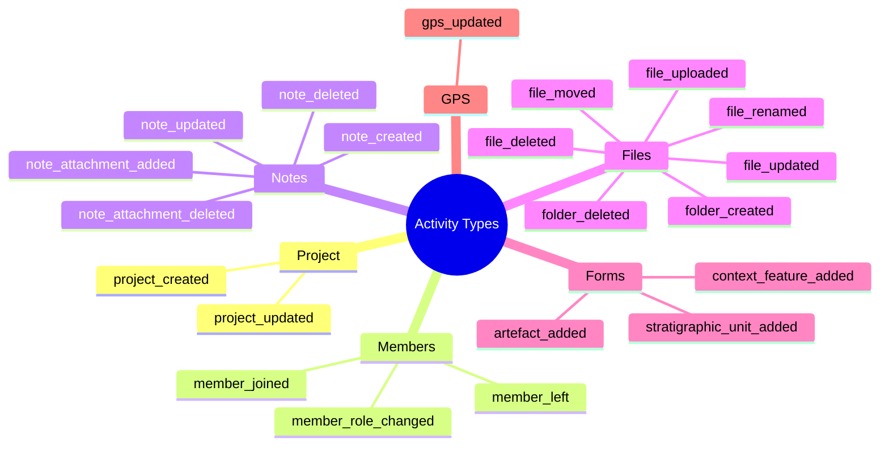
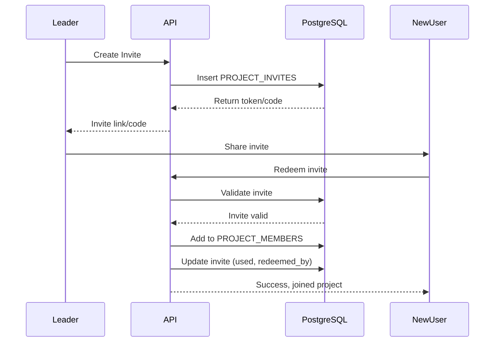
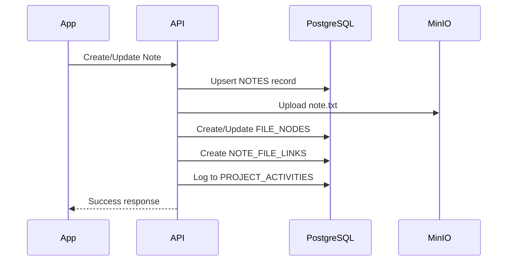

# STRATUM Database Schema - Interactive Diagram

> **Note:** GitHub automatically renders Mermaid diagrams. View this file on GitHub to see the interactive schema.

---

## Complete Entity Relationship Diagram

```mermaid
erDiagram
    USERS {
        string id PK "UUID"
        string firebase_uid UK "Firebase Auth UID"
        string email UK "User email"
        string display_name "Optional name"
        string photo_url "Profile photo"
        datetime created_at "Account created"
        datetime updated_at "Last modified"
        datetime last_login "Last login time"
    }

    PROJECTS {
        string id PK "UUID"
        string name "Project name"
        text description "Description"
        string ran_lmi_id "Romanian Registry ID"
        string owner_id FK "Owner user"
        datetime created_at "Created"
        datetime updated_at "Modified"
        bool is_active "Active status"
    }

    PROJECT_MEMBERS {
        string project_id FK "Project ref"
        string user_id FK "User ref"
        enum role "leader|researcher|guest"
        datetime joined_at "Join date"
    }

    NOTES {
        string id PK "UUID"
        string title "Note title"
        text content "Note content"
        string project_id FK "Parent project"
        string author_id FK "Author user"
        datetime created_at "Created"
        datetime updated_at "Modified"
        datetime last_synced "MinIO sync time"
        int version "Version number"
        enum privacy "private|shared|project|public"
        json shared_with "User IDs list"
    }

    FILE_NODES {
        string id PK "UUID"
        string project_id FK "Parent project"
        string parent_id FK "Parent folder"
        string name "File/folder name"
        enum type "folder|file|note"
        string mime_type "MIME type"
        string size "File size"
        string storage_path "MinIO path"
        bool is_locked "Prevent delete"
        int version "Version number"
        string checksum "File hash"
        string owner_id FK "Owner user"
        enum privacy "private|shared|project|public"
        json shared_with "User IDs list"
        datetime created_at "Created"
        datetime updated_at "Modified"
    }

    FILE_VERSIONS {
        string id PK "UUID"
        string file_node_id FK "Parent file"
        int version "Version number"
        string storage_path "MinIO path"
        string size "File size"
        string checksum "File hash"
        datetime created_at "Created"
        string created_by FK "Creator user"
    }

    NOTE_FILE_LINKS {
        string note_id PK_FK "Note ref"
        string file_node_id UK_FK "FileNode ref"
    }

    NOTE_ATTACHMENTS {
        string id PK "UUID"
        string note_id FK "Parent note"
        string filename "Original name"
        string file_path "MinIO path"
        string file_type "MIME type"
        string file_size "Size"
        datetime uploaded_at "Upload time"
    }

    PROJECT_GPS {
        string project_id PK_FK "Project ref"
        text data "JSON GPS data"
        datetime updated_at "Modified"
    }

    PROJECT_INVITES {
        string token PK "UUID token"
        string code UK "Short code"
        string project_id FK "Project ref"
        enum role "Assigned role"
        string created_by FK "Creator"
        datetime created_at "Created"
        datetime expires_at "Expiration"
        string redeemed_by FK "Redeemer"
        datetime redeemed_at "Redeemed time"
        bool used "Is used"
        int max_uses "Max redemptions"
        int use_count "Current uses"
    }

    PROJECT_ACTIVITIES {
        string id PK "UUID"
        string project_id FK "Project ref"
        string user_id FK "Acting user"
        enum activity_type "Activity type"
        text description "Description"
        text extra_data "JSON data"
        datetime created_at "Timestamp"
    }

    %% Relationships
    USERS ||--o{ PROJECTS : "owns"
    USERS ||--o{ PROJECT_MEMBERS : "joins"
    USERS ||--o{ NOTES : "authors"
    USERS ||--o{ FILE_NODES : "owns"
    USERS ||--o{ FILE_VERSIONS : "creates"
    USERS ||--o{ PROJECT_ACTIVITIES : "performs"
    USERS ||--o{ PROJECT_INVITES : "creates"
    USERS ||--o{ PROJECT_INVITES : "redeems"

    PROJECTS ||--o{ PROJECT_MEMBERS : "has"
    PROJECTS ||--o{ NOTES : "contains"
    PROJECTS ||--o{ FILE_NODES : "contains"
    PROJECTS ||--|| PROJECT_GPS : "has"
    PROJECTS ||--o{ PROJECT_INVITES : "has"
    PROJECTS ||--o{ PROJECT_ACTIVITIES : "logs"

    NOTES ||--o{ NOTE_ATTACHMENTS : "has"
    NOTES ||--|| NOTE_FILE_LINKS : "links"

    FILE_NODES ||--o{ FILE_NODES : "contains"
    FILE_NODES ||--|| NOTE_FILE_LINKS : "backs"
    FILE_NODES ||--o{ FILE_VERSIONS : "versions"
```

---

## Core Tables Diagram



---

## File System Hierarchy



---

## MinIO Storage Structure



---

## Data Flow Architecture



---

## User Roles & Permissions



---

## Privacy Levels



---

## Activity Types



---

## Invite System Flow



---

## Note Sync Flow



---

*View this file on GitHub to see all diagrams rendered interactively.*
