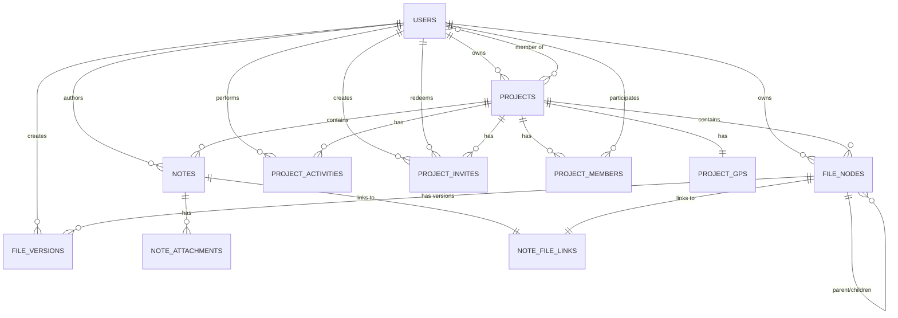
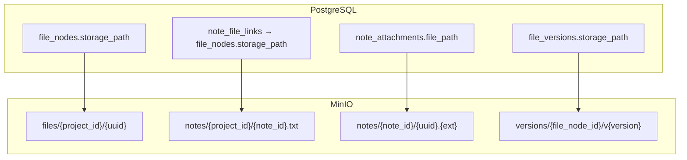

# STRATUM Database Schema Documentation

This document provides a complete overview of the PostgreSQL and MinIO storage architecture used in the STRATUM application.

---

## Architecture Overview

The backend uses a dual-storage architecture:

| Storage | Purpose |
|---------|---------|
| **PostgreSQL** | Relational data: users, projects, notes, file metadata, relationships, access control |
| **MinIO** | S3-compatible object storage: file bytes, note content files, attachments |
| **Firebase** | Authentication only (token verification); user records mirrored in PostgreSQL |

---

## PostgreSQL Schema

### Entity Relationship Diagram



---

### Tables

#### `users`

Stores user information, synchronized with Firebase authentication.

| Column | Type | Constraints | Description |
|--------|------|-------------|-------------|
| `id` | `String` | **PK** | UUID, auto-generated |
| `firebase_uid` | `String` | **UNIQUE**, NOT NULL, INDEX | Firebase authentication UID |
| `email` | `String` | **UNIQUE**, NOT NULL, INDEX | User email address |
| `display_name` | `String` | NULLABLE | User's display name |
| `photo_url` | `String` | NULLABLE | Profile photo URL |
| `created_at` | `DateTime` | DEFAULT now() | Account creation timestamp |
| `updated_at` | `DateTime` | DEFAULT now(), ON UPDATE | Last update timestamp |
| `last_login` | `DateTime` | NULLABLE | Last login timestamp |

---

#### `projects`

Represents archaeological projects/excavation sites.

| Column | Type | Constraints | Description |
|--------|------|-------------|-------------|
| `id` | `String` | **PK** | UUID, auto-generated |
| `name` | `String` | NOT NULL | Project name |
| `description` | `Text` | NULLABLE | Project description |
| `ran_lmi_id` | `String` | NULLABLE | Romanian National Archaeological Registry ID |
| `owner_id` | `String` | **FK** → `users.id`, ON DELETE CASCADE | Project owner |
| `created_at` | `DateTime` | DEFAULT now() | Creation timestamp |
| `updated_at` | `DateTime` | DEFAULT now(), ON UPDATE | Last update timestamp |
| `is_active` | `Boolean` | DEFAULT true | Active status |

**Relationships:**
- `owner` → User (many-to-one)
- `members` → Users via `project_members` (many-to-many)
- `notes` → Notes (one-to-many, cascade delete)
- `files` → FileNodes (one-to-many, cascade delete)
- `gps` → ProjectGPS (one-to-one)
- `invites` → ProjectInvites (one-to-many, cascade delete)
- `activities` → ProjectActivities (one-to-many, cascade delete)

---

#### `project_members` (Association Table)

Manages project membership with roles.

| Column | Type | Constraints | Description |
|--------|------|-------------|-------------|
| `project_id` | `String` | **FK** → `projects.id`, ON DELETE CASCADE | Project reference |
| `user_id` | `String` | **FK** → `users.id`, ON DELETE CASCADE | User reference |
| `role` | `Enum(UserRole)` | DEFAULT 'guest' | Member role |
| `joined_at` | `DateTime` | DEFAULT now() | Join timestamp |

**UserRole Enum Values:**
- `leader` - Full project management access
- `researcher` - Read/write access to data
- `guest` - Limited read access

---

#### `notes`

Stores project notes/field notes.

| Column | Type | Constraints | Description |
|--------|------|-------------|-------------|
| `id` | `String` | **PK** | UUID, auto-generated |
| `title` | `String` | NOT NULL | Note title |
| `content` | `Text` | NULLABLE | Note content |
| `project_id` | `String` | **FK** → `projects.id`, ON DELETE CASCADE | Parent project |
| `author_id` | `String` | **FK** → `users.id`, ON DELETE CASCADE | Note author |
| `created_at` | `DateTime` | DEFAULT now() | Creation timestamp |
| `updated_at` | `DateTime` | DEFAULT now(), ON UPDATE | Last update timestamp |
| `last_synced` | `DateTime` | NULLABLE | Last sync with MinIO |
| `version` | `Integer` | DEFAULT 1, NOT NULL | Version number for conflict resolution |
| `privacy` | `Enum(PrivacyLevel)` | DEFAULT 'project', NOT NULL | Access control level |
| `shared_with` | `JSON` | NULLABLE | List of user IDs (for SHARED privacy) |

**PrivacyLevel Enum Values:**
- `private` - Only owner can see
- `shared` - Shared with specific users
- `project` - All project members can see (default)
- `public` - Anyone with project access can see

**Relationships:**
- `project` → Project (many-to-one)
- `author` → User (many-to-one)
- `attachments` → NoteAttachments (one-to-many, cascade delete)
- `file_link` → NoteFileLink (one-to-one)

---

#### `file_nodes`

Hierarchical file/folder structure for project files.

| Column | Type | Constraints | Description |
|--------|------|-------------|-------------|
| `id` | `String` | **PK** | UUID, auto-generated |
| `project_id` | `String` | **FK** → `projects.id`, ON DELETE CASCADE, INDEX | Parent project |
| `parent_id` | `String` | **FK** → `file_nodes.id`, ON DELETE CASCADE, INDEX, NULLABLE | Parent folder (null = root) |
| `name` | `String` | NOT NULL | File/folder name |
| `type` | `Enum(FileNodeType)` | NOT NULL, DEFAULT 'file' | Node type |
| `mime_type` | `String` | NULLABLE | MIME type for files |
| `size` | `String` | NULLABLE | File size |
| `storage_path` | `String` | NULLABLE | MinIO object key/path |
| `is_locked` | `Boolean` | DEFAULT false | Prevents deletion/moving |
| `version` | `Integer` | DEFAULT 1, NOT NULL | Version number |
| `checksum` | `String` | NULLABLE | MD5/SHA256 hash |
| `owner_id` | `String` | **FK** → `users.id`, ON DELETE SET NULL, INDEX | File owner |
| `privacy` | `Enum(PrivacyLevel)` | DEFAULT 'project', NOT NULL | Access control level |
| `shared_with` | `JSON` | NULLABLE | List of user IDs |
| `created_at` | `DateTime` | DEFAULT now() | Creation timestamp |
| `updated_at` | `DateTime` | DEFAULT now(), ON UPDATE | Last update timestamp |

**FileNodeType Enum Values:**
- `folder` - Directory container
- `file` - Regular file
- `note` - Note backing file

**Constraints:**
- `uq_file_nodes_sibling_name`: UNIQUE(`project_id`, `parent_id`, `name`) - No duplicate names in same folder
- `ix_file_nodes_project_parent`: INDEX(`project_id`, `parent_id`) - Fast folder listings
- `ix_file_nodes_owner`: INDEX(`owner_id`)

**Relationships:**
- `project` → Project (many-to-one)
- `parent` → FileNode (self-referential, many-to-one)
- `children` → FileNodes (one-to-many, cascade delete)
- `owner` → User (many-to-one)
- `versions` → FileVersions (one-to-many, cascade delete)
- `note_link` → NoteFileLink (one-to-one)

---

#### `file_versions`

Version history for files.

| Column | Type | Constraints | Description |
|--------|------|-------------|-------------|
| `id` | `String` | **PK** | UUID, auto-generated |
| `file_node_id` | `String` | **FK** → `file_nodes.id`, ON DELETE CASCADE, INDEX | Parent file node |
| `version` | `Integer` | NOT NULL | Version number |
| `storage_path` | `String` | NOT NULL | MinIO path for this version |
| `size` | `String` | NULLABLE | File size |
| `checksum` | `String` | NULLABLE | File checksum |
| `created_at` | `DateTime` | DEFAULT now() | Version creation timestamp |
| `created_by` | `String` | **FK** → `users.id`, ON DELETE SET NULL, NULLABLE | User who created version |

**Constraints:**
- `uq_file_version`: UNIQUE(`file_node_id`, `version`)
- `ix_file_versions_file_node`: INDEX(`file_node_id`)

---

#### `note_file_links`

1:1 mapping between Notes and their backing .txt files in MinIO.

| Column | Type | Constraints | Description |
|--------|------|-------------|-------------|
| `note_id` | `String` | **PK**, **FK** → `notes.id`, ON DELETE CASCADE | Note reference |
| `file_node_id` | `String` | **FK** → `file_nodes.id`, ON DELETE CASCADE, UNIQUE | File node reference |

---

#### `note_attachments`

Stores metadata for note attachments (images, etc.).

| Column | Type | Constraints | Description |
|--------|------|-------------|-------------|
| `id` | `String` | **PK** | UUID, auto-generated |
| `note_id` | `String` | **FK** → `notes.id`, ON DELETE CASCADE | Parent note |
| `filename` | `String` | NOT NULL | Original filename |
| `file_path` | `String` | NOT NULL | MinIO object path |
| `file_type` | `String` | NOT NULL | MIME type (image/jpeg, etc.) |
| `file_size` | `String` | NULLABLE | File size |
| `uploaded_at` | `DateTime` | DEFAULT now() | Upload timestamp |

---

#### `project_gps`

Stores GPS/mapping data for projects.

| Column | Type | Constraints | Description |
|--------|------|-------------|-------------|
| `project_id` | `String` | **PK**, **FK** → `projects.id`, ON DELETE CASCADE | Project reference |
| `data` | `Text` | NOT NULL, DEFAULT '{}' | JSON blob containing GPS data |
| `updated_at` | `DateTime` | DEFAULT now(), ON UPDATE | Last update timestamp |

**JSON Structure:**
```json
{
  "work": {
    "points": [...],
    "closed": boolean
  },
  "sites": [
    {
      "points": [...],
      "closed": boolean
    }
  ]
}
```

---

#### `project_invites`

Manages project invitation links and codes.

| Column | Type | Constraints | Description |
|--------|------|-------------|-------------|
| `token` | `String` | **PK** | UUID invite token |
| `code` | `String` | UNIQUE, NULLABLE, INDEX | Short code (e.g., "PRJ-ABC123") |
| `project_id` | `String` | **FK** → `projects.id`, ON DELETE CASCADE, INDEX | Project reference |
| `role` | `Enum(UserRole)` | NOT NULL, DEFAULT 'guest' | Role assigned on join |
| `created_by` | `String` | **FK** → `users.id`, ON DELETE SET NULL, NULLABLE | Creator user |
| `created_at` | `DateTime` | DEFAULT now() | Creation timestamp |
| `expires_at` | `DateTime` | NULLABLE | Expiration timestamp |
| `redeemed_by` | `String` | **FK** → `users.id`, ON DELETE SET NULL, NULLABLE | User who redeemed |
| `redeemed_at` | `DateTime` | NULLABLE | Redemption timestamp |
| `used` | `Boolean` | DEFAULT false | Whether invite is used |
| `max_uses` | `Integer` | NULLABLE | Maximum uses (null = unlimited) |
| `use_count` | `Integer` | DEFAULT 0 | Current redemption count |

---

#### `project_activities`

Activity log/audit trail for projects.

| Column | Type | Constraints | Description |
|--------|------|-------------|-------------|
| `id` | `String` | **PK** | UUID, auto-generated |
| `project_id` | `String` | **FK** → `projects.id`, ON DELETE CASCADE, INDEX | Project reference |
| `user_id` | `String` | **FK** → `users.id`, ON DELETE SET NULL, NULLABLE | Acting user |
| `activity_type` | `Enum(ActivityType)` | NOT NULL | Type of activity |
| `description` | `Text` | NOT NULL | Human-readable description |
| `extra_data` | `Text` | NULLABLE | JSON blob for additional data |
| `created_at` | `DateTime` | DEFAULT now(), INDEX | Activity timestamp |

**Constraints:**
- `ix_project_activities_project_created`: INDEX(`project_id`, `created_at`)

**ActivityType Enum Values:**

| Category | Activity Types |
|----------|----------------|
| Project | `project_created`, `project_updated` |
| Members | `member_joined`, `member_left`, `member_role_changed` |
| Notes | `note_created`, `note_updated`, `note_deleted`, `note_attachment_added`, `note_attachment_deleted` |
| Files | `file_uploaded`, `file_updated`, `file_deleted`, `folder_created`, `folder_deleted`, `file_moved`, `file_renamed` |
| Forms | `context_feature_added`, `stratigraphic_unit_added`, `artefact_added` |
| GPS | `gps_updated` |

---

## MinIO Object Storage Schema

MinIO provides S3-compatible object storage for all binary data.

### Bucket Structure

All objects are stored in a single bucket (configurable via `MINIO_BUCKET_NAME`).

```
bucket/
├── files/
│   └── {project_id}/
│       └── {uuid}                    # Uploaded files
├── notes/
│   ├── {project_id}/
│   │   └── {note_id}.txt             # Note backing files
│   └── {note_id}/
│       └── {uuid}.{ext}              # Note attachments
└── versions/
    └── {file_node_id}/
        └── v{version}_{uuid}         # File version history
```

### Object Path Patterns

| Object Type | Path Pattern | Description |
|-------------|--------------|-------------|
| **Uploaded Files** | `files/{project_id}/{uuid}` | General file uploads |
| **Note Content** | `notes/{project_id}/{note_id}.txt` | Note backing .txt files |
| **Note Attachments** | `notes/{note_id}/{uuid}.{ext}` | Images/files attached to notes |
| **File Versions** | `versions/{file_node_id}/v{version}_{uuid}` | Historical file versions |

### Mapping to PostgreSQL



---

## Data Flow Summary

```
┌─────────────────────────────────────────────────────────────────────┐
│                         Client Application                          │
└─────────────────────────────────────────────────────────────────────┘
                                    │
                                    ▼
┌─────────────────────────────────────────────────────────────────────┐
│                          Firebase Auth                              │
│                     (ID Token Verification)                         │
└─────────────────────────────────────────────────────────────────────┘
                                    │
                                    ▼
┌─────────────────────────────────────────────────────────────────────┐
│                         FastAPI Backend                             │
└─────────────────────────────────────────────────────────────────────┘
                    │                               │
                    ▼                               ▼
┌───────────────────────────────┐   ┌───────────────────────────────┐
│         PostgreSQL            │   │           MinIO               │
│  • Users, Projects, Notes     │   │  • File bytes                 │
│  • File metadata              │   │  • Note content (.txt)        │
│  • Relationships              │   │  • Attachments                │
│  • Access control             │   │  • Version history            │
│  • Activity logs              │   │                               │
└───────────────────────────────┘   └───────────────────────────────┘
```

---

## Key Design Principles

1. **Metadata/Binary Separation**: PostgreSQL stores metadata and relationships; MinIO stores actual file bytes
2. **Hierarchical Files**: `file_nodes` supports tree structure via `parent_id` self-reference
3. **Version Control**: Both notes and files support versioning for conflict resolution
4. **Privacy Controls**: Granular privacy levels (private, shared, project, public) on notes and files
5. **Audit Trail**: `project_activities` logs all significant actions
6. **Soft References**: Foreign keys use `ON DELETE CASCADE` or `ON DELETE SET NULL` appropriately
7. **Invite System**: Supports both single-use and multi-use invites with expiration

---

## Indexes Summary

| Table | Index | Columns | Purpose |
|-------|-------|---------|---------|
| `users` | Primary | `id` | Primary key |
| `users` | Unique | `firebase_uid` | Firebase lookup |
| `users` | Unique | `email` | Email lookup |
| `file_nodes` | Composite | `project_id`, `parent_id` | Folder listing queries |
| `file_nodes` | Single | `owner_id` | Owner-based queries |
| `file_nodes` | Unique | `project_id`, `parent_id`, `name` | Prevent duplicate names |
| `file_versions` | Single | `file_node_id` | Version history lookup |
| `file_versions` | Unique | `file_node_id`, `version` | Unique versions |
| `project_activities` | Composite | `project_id`, `created_at` | Timeline queries |
| `project_invites` | Single | `code` | Invite code lookup |
| `project_invites` | Single | `project_id` | Project invites lookup |

---

*Last updated: February 2026*
